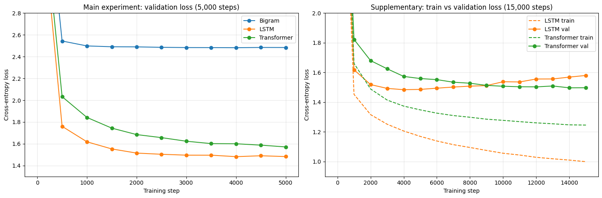
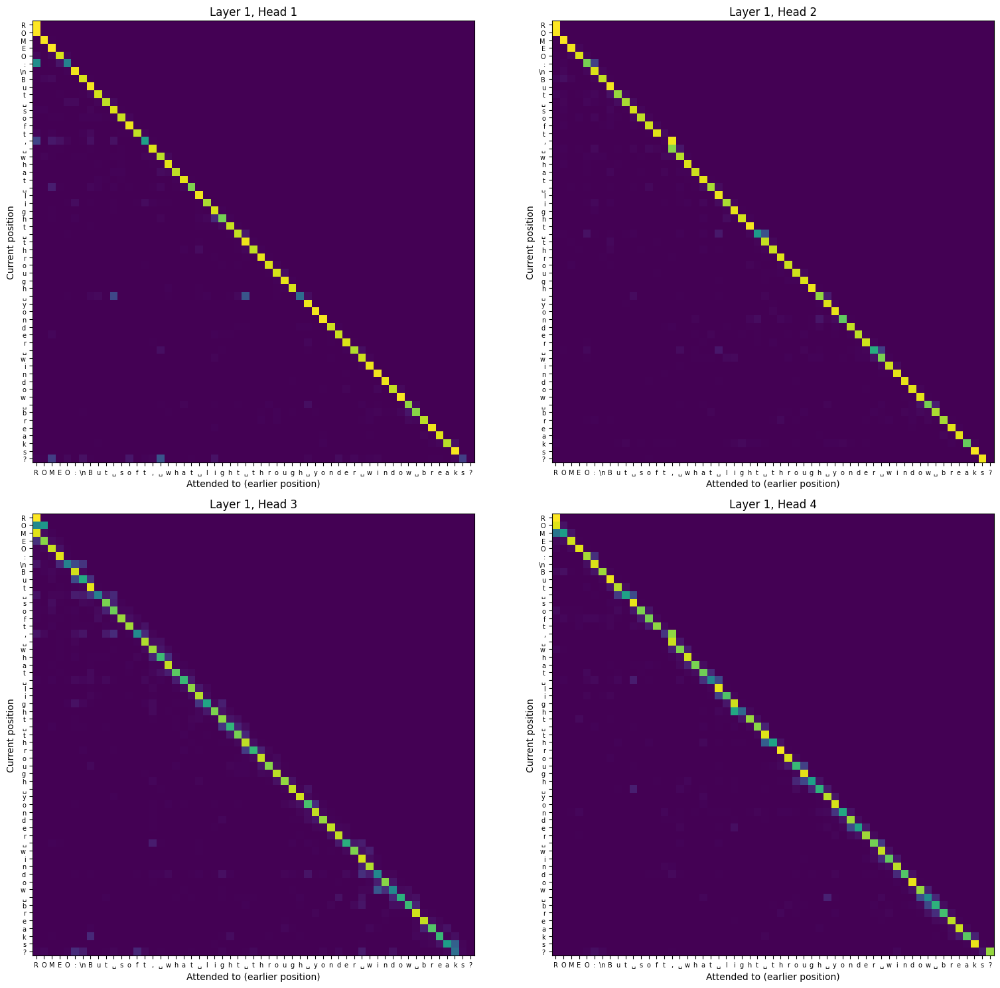
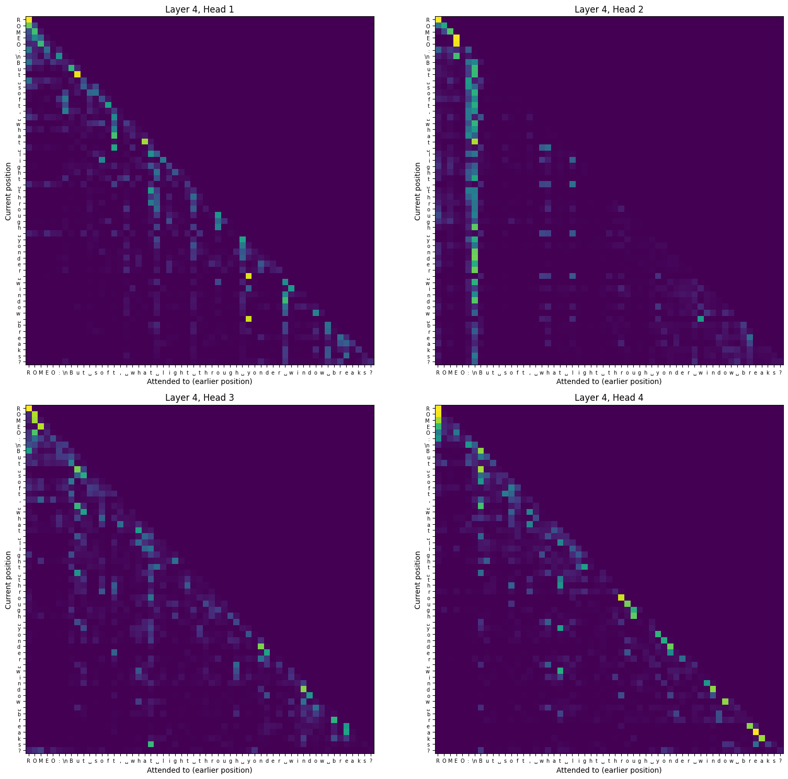
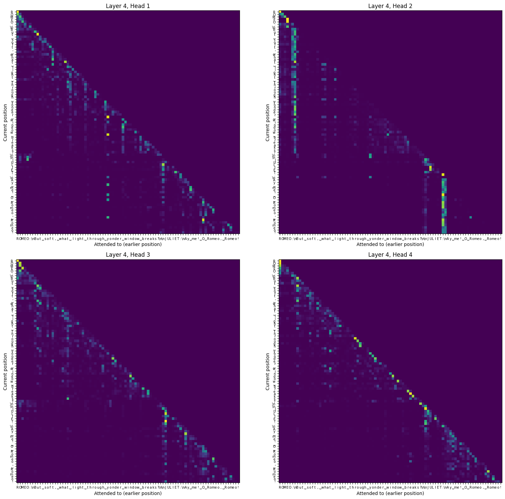

# Comparing Three Language Models on Tiny Shakespeare

**Author:** Wei Dong

**Course:** AAI 6620 Applied NLP, Fall 2026

**Task:** Character-level next-token prediction

This project compares a bigram model, an LSTM, and a small Transformer on the same task: given the previous characters, predict the next one. The goal isn't to build the strongest model possible. It's to see how each architecture uses context, how that changes the results, and what attention actually adds.

## Repository Structure

```
aai6620-midterm-three-models/
├── README.md
├── aai6620_midterm_three_models.ipynb   # all code, outputs, and analysis
├── ai_use_summary.md
├── results/
│   ├── results.json                     # losses, training times, loss curves for every run
│   └── samples.json                     # generated text from every model
└── figures/
    ├── loss_curves.png
    ├── attention_layer1.png
    ├── attention_layer4.png
    └── attention_two_speakers.png
```

## How to Run

1. Open `aai6620_midterm_three_models.ipynb` in Google Colab.
2. Go to **Runtime → Change runtime type** and select **T4 GPU**.
3. Go to **Runtime → Run all**.

The notebook downloads the dataset on its own, and everything it needs (PyTorch, pandas, matplotlib) comes preinstalled in Colab. On a T4 GPU the main experiment takes about 6 minutes, and the whole notebook, including the longer supplementary runs, takes about 25 minutes.

## Task and Dataset

The task is character-level language modeling. Every character is one token, and at each position the model has to predict the next character from the ones before it.

I used **Tiny Shakespeare**, a collection of Shakespeare's plays from Andrej Karpathy's char-rnn repository. It has 1,115,394 characters and a vocabulary of 65 unique characters (letters, punctuation, space, and newline). The first 90% (1,003,854 characters) is used for training and the last 10% (111,540 characters) for validation.

**Download:** the notebook fetches the file automatically from
`https://raw.githubusercontent.com/karpathy/char-rnn/master/data/tinyshakespeare/input.txt`

## The Three Models

### Model 1: Bigram

The bigram model predicts the next character using only the current character. It's basically a 65 × 65 lookup table where each row holds the scores for which character tends to come next. It uses the single previous character and ignores everything else, so it has no idea what word it's in or who's speaking. That's why it can learn simple pairs like "q" followed by "u", but it can't spell longer words or hold a sentence together.

### Model 2: LSTM

The LSTM reads the text one character at a time and carries a hidden state forward, which works like a running summary of everything it has read so far. Its prediction at each position depends on the whole chunk up to that point, not just the last character, so it can keep track of the word it's spelling and the line it's in. The catch is that everything has to fit into one fixed-size hidden vector, so older information gets squeezed out as the text goes on, and characters have to be processed in order. My version has 2 layers, 128-dimensional embeddings, and a 256-dimensional hidden state.

### Model 3: Small Transformer

Instead of squeezing the past into one hidden state, the Transformer lets every position look directly at every earlier position and decide which ones matter. My model includes:

- **Token embeddings** that turn each character into a 128-dimensional vector
- **Positional embeddings** that give the model a sense of order, since attention alone doesn't know which character came first
- **Causal self-attention** with 4 heads per layer, where each position builds its output as a learned, content-based mix of earlier positions and can't peek at the future
- **Feedforward layers** that process each position after attention has gathered the context
- **An output layer** that turns the final vector at each position into scores for the 65 characters

These are stacked into 4 blocks with residual connections and layer normalization.

## Fair Comparison Setup

All three models use the same data split, tokenization, batch size, context length, training steps, and evaluation schedule. The LSTM and Transformer were also kept at a similar size and share the same learning rate and dropout rate, so the comparison is mostly about architecture rather than model size.

| Setting | Value |
|:--|:--|
| Batch size | 64 |
| Context length | 128 characters |
| Training steps | 5,000 (main), 15,000 (supplementary, LSTM and Transformer only) |
| Evaluation | Every 500 steps, averaged over 200 random batches |
| Optimizer | AdamW |
| Learning rate | 1e-2 for the bigram, 1e-3 for the LSTM and Transformer |
| Dropout | 0.2 (LSTM and Transformer) |
| Parameters | Bigram 4,225 / LSTM 946,625 / Transformer 824,897 |
| Random seed | 1337 |
| Hardware | Google Colab, NVIDIA T4 GPU |

Training time only counts the actual training steps, not the time spent on evaluation.

## Results

| Model                   | Params   |   Train Loss |   Val Loss |   Best Val Loss |   Train/Val Gap |   Training Time (s) | Text Quality   | Notes                                             |
|:------------------------|:---------|-------------:|-----------:|----------------:|----------------:|--------------------:|:---------------|:--------------------------------------------------|
| Bigram                  | 4,225    |        2.455 |      2.484 |           2.482 |           0.029 |                15.2 | Low            | Only sees one character; plateaus by step 2000    |
| LSTM                    | 946,625  |        1.167 |      1.483 |           1.482 |           0.316 |               126.9 | Medium         | Best val loss in main run; starting to overfit    |
| Transformer             | 824,897  |        1.353 |      1.571 |           1.571 |           0.219 |               187.4 | Medium         | Val loss still dropping at step 5000              |
| LSTM (15k steps)        | 946,625  |        1.000 |      1.580 |           1.484 |           0.581 |               405.6 | High           | Clear overfitting; val loss rises after step 4000 |
| Transformer (15k steps) | 824,897  |        1.246 |      1.497 |           1.497 |           0.251 |               561.3 | High           | Keeps improving; train/val gap stays small        |

The first three rows are the main comparison. The last two are a supplementary experiment where I trained the LSTM and Transformer three times longer with the exact same settings. Text Quality is my own judgment from reading the samples.



## Generated Samples

Each model generated 500 characters from the same starting point and the same random seed.

**Bigram**
```
I
O: asafite tis, te othut mod thand he, preckn,

Henthim, achishelapinisers we s, orean,
TAUCluprt, ody inde Miced tlat mang yofowhas

Thind.
UCESer url hathapr me machan fl haisu d iere--sthurore cense wn ce me, wouss t avest t, metha'el me herng INGS:

D:BRGLONGof ind s heve she, ENVI an ndowe:
LUSio be's lore we, ba ph, RD foue t he ososour talunghimybr g y stckis thtin;
Bee s mire akns t
Thanesa amnfod bs as Yow:
K:
Tharease V: on my feristhatessotrilorule, maripakn 'sealanks, g duthintide.
```

**LSTM**
```
Is that fair pity see-theart distands,
Septentation will go along and will.
I doubt that, stay upon contrive in your lady
And young princely ament to us, hath promised,
My flowers he is never unor ice, and make:
Have she meet to thee?

PRINCE EDWARD:
See last one of my husband, she, being not a
presence at the man, and speak perfuce; he hath loved
under fortune and the great Beekship's office
To 'we not for his speech, so Duke of Verona,
As I same sasks alone! I must all the lands,
You are to-ni
```

**Transformer**
```
First Senator:
What on't, my stay.

Clown:
There's now madam!

First Muster:
I say, good state her, or night ever followed
Himself, sir, that saw thou, that great implain,
Her eyes his wife, unor it subject a man,
Were thee sword, with elm; for he said with wound--

DUKE VINCENTIO:
My lord; what say, or that was my bodies,
Richmon to make some this flimble grief care their breeds.

VOLUMNIA:
Thus say may exch as now:
Keep my assure on my father, as so take upon me;
For Bolingbroke gods forth; a
```

<details>
<summary><b>Samples from the 15,000 step runs</b></summary>

**LSTM (15k steps)**
```
Which was the king may dut my stay do me,
And now he came, and be lap with conclusion!

KING EDWARD IV:
Happy not your grace in hand, I'll have a better,
And great flack not of it.

First Officer:
It is not them, and so to every words.

RICHARD:
Ay, as thou spokest, mighty friar, O, be brought well.

GLOUCESTER:
Why, no more perform; no, so I am.

LEONTES:
Go you consit,
And prepare not worth the whateen.

MENENIUS:
Note for this be on my father, and I
know you are honest. But, be sit up into
Th
```

**Transformer (15k steps)**
```
I
Our each back'd the time modest no heart: conturney,
To once the appeal comes of our honour lust.

CAMILLO:
My lord, the common's poor hand.

CAPULET:
Now I will be changed him.

Nurse:
O brut revenge, wilt we are as now even to me?

PRINCE EDWARD:
Saw lay what now in Warwick shall Norfolk, and say
Go beat to harved dipp'd persue to make some talks
In Corioli and wilt thou hast seen to thy brother? O,
When svantage: thy streaks be on my father's sas
Are I must make all the hands, give men,
And
```

</details>

## Analysis

### Which model performed best?

In the main 5,000 step comparison, the **LSTM** did best with a validation loss of 1.483, ahead of the Transformer (1.571) and way ahead of the bigram (2.484). That surprised me at first. The longer runs changed the picture, though. Trained for 15,000 steps, the LSTM overfit badly and its validation loss climbed back up to 1.580, while the Transformer kept improving and finished at 1.497. So the answer depends on the training budget: the LSTM learns faster at this small scale, but the Transformer holds up better when you keep training.

### Which model trained fastest?

The **bigram**, by a mile, at 15.2 seconds. It only has 4,225 parameters. The LSTM took 126.9 seconds and the Transformer 187.4 seconds. The Transformer being slower than the LSTM is probably due in large part to my simple implementation, which computes each attention head separately in a Python loop. With a model this small, the GPU spends a lot of time on overhead rather than actual computation.

### Which model generated the most realistic text?

The bigram's output is mostly gibberish, though it does copy the play format with capitalized names and colons. The LSTM and Transformer are both a huge step up, with mostly real English words, line breaks in the right places, and speaker labels for real Shakespeare characters. Between the two main samples, the LSTM's words are a little cleaner, while the Transformer's sample has the most play-like structure, moving through several short dialogue turns. The 15,000 step samples are the most realistic of all, and some of the Transformer's lines, like "My lord, the common's poor hand.", come pretty close to readable. None of the models actually say anything meaningful, though.

### What did the Transformer improve compared to the other models?

The biggest improvement is how it uses context. The LSTM has to carry everything through one hidden state, while the Transformer can look directly at any earlier position. It also overfit much less: its train/val gap stayed around 0.22 to 0.25, while the LSTM's grew from 0.32 to 0.58 with longer training. One caveat is that the Transformer applies dropout in more places than the LSTM, and it also learns more slowly, so part of that difference may not come from the architecture alone.

### Was the improvement worth the added complexity?

At this scale, not by much. With a 1 MB dataset and fewer than a million parameters, the LSTM matched or beat the Transformer at its best checkpoint (1.484 versus 1.497) with a quarter of the training. But the Transformer's advantages, like direct access to any earlier position, resistance to overfitting, and the ability to process all positions in parallel, are exactly the ones that matter more as data and models grow. For a small project like this the LSTM is the practical choice; for anything bigger, the Transformer's extra complexity starts paying for itself.

### What did I learn about attention?

I visualized the attention weights of the Transformer on a line from Romeo and Juliet. The first layer mostly looks at each character itself and its immediate neighbors, which is pretty close to what the bigram does.



The last layer is completely different, and each head picks up its own job. One head (Layer 4, Head 2) pays a lot of attention to the line break right after "ROMEO:" from almost every later character. Others focus on spaces, word beginnings, and the previous few letters inside the current word.



I wasn't sure whether Head 2 was tracking where the speech started or was just an "attention sink" that parks extra attention on a fixed early spot. To test it, I fed in a passage with two speakers. When Juliet starts talking, the bright column jumps to the line break after "JULIET:" and the old one fades out, so the head really does seem to track the start of the current speech. Nobody told the model what a speech is; it picked that up from the data.



## What I Learned

This project taught me a lot more than which model wins. Reading the loss curves side by side showed me what overfitting actually looks like, with the training loss falling while the validation loss turns back up. It also showed me how easy it is to draw the wrong conclusion from a single training budget, since the main experiment and the longer runs pointed in different directions. Setting up a fair comparison made me pay attention to details I would have skipped before, like matching model sizes and keeping the settings the same, and even then I found a difference in dropout that I had to point out. Finally, visualizing attention and then testing a hypothesis about one head made the mechanism feel real. Before this, attention was mostly a formula to me. Now I've seen what it actually does.

## Final Reflection

**After comparing bigram, non-transformer, and transformer models, what do you think makes transformers powerful for language modeling?**

Going into this project I assumed the Transformer would just win, and it didn't, at least not right away. With the same 5,000 steps, the LSTM had the lower validation loss and trained faster. That ended up being one of the most useful things I learned, because it made me think harder about where the Transformer's strength actually comes from.

I think the biggest thing is how it handles context. The bigram sees one character. The LSTM can see everything in principle, but it has to cram all of it into one fixed-size hidden state, and older details get squeezed out. The Transformer doesn't have that bottleneck. Every position can look straight back at any earlier position and decide, based on the content, what's worth paying attention to. The Head 2 experiment showed this really clearly: the model learned on its own to look back at the line where the current speech started, and to switch to the new line when the speaker changed. Nobody programmed that in.

The second thing is that attention is split across several heads and stacked into layers. Each head can specialize, so one tracks the speaker while others work on spelling and word boundaries, and the deeper layers combine all of that into a bigger picture. On top of that, a Transformer processes all positions at the same time during training, which is a big reason it scales so well to huge datasets and modern GPUs. In my small setup that advantage was hidden by implementation overhead, but it matters a lot at real scale.

So is the extra complexity worth it? For a 1 MB dataset and a model under a million parameters, honestly not by much, since the LSTM is a tough baseline here. But the longer training run hinted at the bigger picture: the LSTM started overfitting after about 4,000 steps, while the Transformer kept improving (though some of that may come from the extra dropout it gets). My takeaway is that Transformers aren't powerful because they're better at everything. They're powerful because their way of using context keeps paying off as you give them more data, more training, and longer text, which is exactly the direction language models have gone.

## Responsible AI Use

See [ai_use_summary.md](ai_use_summary.md) for details.
